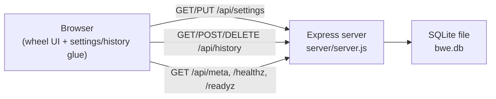

# BWE - Big Wheel of Excitement

A prize/name-picker wheel, wrapped as a small stateful web app for teaching
Kubernetes persistent storage. Spin the wheel, pick a winner, and everything
you configure - the wheel's names, title/subtitle, and the full run history -
is persisted server-side so it survives page reloads, container restarts, and
(when deployed to Kubernetes) pod rescheduling.

## Architecture



- **Frontend**: a compiled React wheel (`assets/`) plus small vanilla-JS glue
  files (`bwe-core.js`, `bootstrap.js`, `settings.js`, `history.js`) that talk
  to the backend and feed data into the wheel through its own CSV-upload path
  (see comments in `bwe-core.js` for how/why).
- **Backend**: `server/` is a small Express app that serves the static
  frontend and exposes a JSON API backed by SQLite (`better-sqlite3`).
- **Persistence**: everything lives in one SQLite file under `DATA_DIR`
  (default `/data/bwe.db`). Locally that's a bind-mounted `./data` folder; in
  Kubernetes it's a PersistentVolumeClaim.

## Features

- Editable title/subtitle and wheel names (⚙️ icon), applied live - no reload.
- Persistent **run history** (🏆 icon): every winner is recorded with a
  timestamp, with "Clear History" and "Export CSV" actions.
- Demo data seeded automatically on first boot so the wheel is never empty.
- A small `pod: ... / node: ...` badge (via the Kubernetes Downward API) that
  makes it obvious the app's compute is ephemeral while its data isn't.
- `/healthz` and `/readyz` endpoints for real liveness/readiness probes.

## Local development

```bash
cd server
npm install
DATA_DIR=../data PORT=8080 npm start
```

PowerShell equivalent:

```powershell
cd server
npm install
$env:DATA_DIR = '../data'
$env:PORT = '8080'
npm start
```

Or with Docker Compose (mirrors the Kubernetes volume-mount layout):

```bash
docker compose up --build
```

Open <http://localhost:8080>. Data written to `./data` survives restarts.

Run the API and compiled-wheel bridge regression tests with:

```bash
cd server
npm test
```

## Deploying to Kubernetes

See [`k8s/README.md`](k8s/README.md) for the full bootcamp script: building
the image, applying the manifests, and two guided exercises -
"delete the pod, watch your data survive" and "scale to 2 replicas, observe
what `ReadWriteOnce` actually constrains."

## Repository layout

```
index.html, assets/, *.png/svg      compiled React wheel + art (unchanged)
bwe-core.js, bootstrap.js           shared API client + initial load/injection
settings.js, settings.css           settings modal (title/subtitle/names)
history.js, history.css             run-history modal + winner capture
server/                             Express + SQLite backend
  server.js, db.js, seed/           API, persistence, default demo data
Dockerfile, docker-compose.yml      container build + local smoke test
k8s/                                Kubernetes manifests + bootcamp exercises
```
